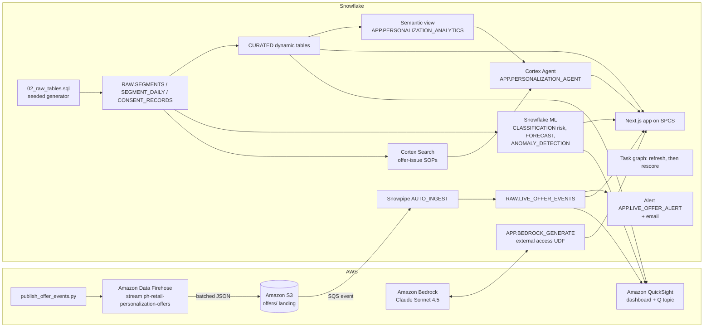

# Philippines Retail Loyalty Personalization - Offer Fatigue and Opt-out Risk

End-to-end loyalty personalization for **40 aggregate member segments of a fictional Philippine omnichannel retailer, in 5 cities** (Pasig City, Mandaue City, General Santos City, Zamboanga City, Angeles City) using Snowflake, optionally with AWS: from a live offer issue to a 7-day member opt-out risk score, an alert email and an AI action memo for the CRM personalization team.

## Architecture

A loyalty-personalization pipeline built on **Snowflake** (Dynamic Tables, Snowflake ML, Cortex Search, Cortex Agent, Cortex AI_COMPLETE, SPCS) and, in the full build, **AWS** (Amazon Data Firehose, S3, Bedrock Claude, QuickSight + Amazon Q). Offer events land in `RAW.LIVE_OFFER_EVENTS`. Dynamic tables curate 90 days of segment-day history: offers sent, offer-attributed sales, offer issues raised, member opt-outs, spam reports, clean offer rate and creative refresh compliance. Snowflake ML scores 7-day member opt-out risk per segment, forecasts program-wide offer-issue volume and flags ignore rate anomalies. A Cortex Agent answers questions with SOP citations, and an LLM drafts the CRM action memo. Segments are aggregates; there are no member-level records.

Interactive diagrams (hover for object names): [Snowflake only](docs/architecture-snowflake.html) | [AWS + Snowflake](docs/architecture-aws.html). The app shows both on its Architecture & Data tab, the current build first. Regenerate them with `python3 docs/build_architecture.py`.



The Snowflake-only build drops the AWS subgraph: `APP.SIMULATE_OFFER_EVENTS` writes to `RAW.LIVE_OFFER_EVENTS`, and the app calls Cortex `AI_COMPLETE` instead of the Bedrock UDF.

## Snowflake Capabilities

| Capability | Implementation |
|-----------|---------------|
| Dynamic Tables | `CURATED.KPI_SUMMARY`, `PERFORMANCE_SUMMARY`, `ISSUE_SUMMARY`, `TREND_ANALYSIS` from the RAW tables |
| Snowflake ML | CLASSIFICATION 7-day member opt-out risk (`ML.OPTOUT_RISK_SCORES`), 14-day offer-issue FORECAST, ignore rate ANOMALY_DETECTION |
| Cortex Search | 14 synthetic offer-issue handling SOPs (one per category affinity and issue type) in `SEARCH.ISSUE_SOP_SEARCH` |
| Semantic View | `APP.PERSONALIZATION_ANALYTICS` over segments, issue types, daily totals and risk |
| Cortex Agent | `APP.PERSONALIZATION_AGENT`: Cortex Analyst over the semantic view plus Cortex Search for SOP citations |
| Cortex AI | `AI_COMPLETE('claude-sonnet-4-5')` for grounded answers, and for the action memo in the Snowflake-only build |
| Alerts + Tasks | `APP.LIVE_OFFER_ALERT` logs ISSUE events and sends email; task graph `TASK_REFRESH_CURATED`, then `TASK_RESCORE_RISK` |
| Snowpark Container Services | Next.js app `APP.PH_RETAIL_PERSONALIZATION_APP` with 6 tabs: Executive Cockpit, Predictive, Controls, Live Offer Events, Ask AI, Architecture & Data |
| Snowpipe | `RAW.LIVE_OFFER_EVENTS_PIPE` AUTO_INGEST from S3 (AWS build only) |

## AWS Services

Used only in the AWS + Snowflake build. Offer sends and redemptions are an event stream, so ingestion uses Amazon Data Firehose.

| Service | Role in Demo |
|---------|-------------|
| Amazon Data Firehose | Direct PUT stream `ph-retail-personalization-offers` receives simulated offer events and writes batches to S3 |
| Amazon S3 | Landing bucket (`offers/`). An event notification goes to the Snowpipe SQS queue |
| Amazon Bedrock | Claude Sonnet 4.5 writes the action memo, called from Snowflake through an external-access UDF |
| Amazon QuickSight | DIRECT_QUERY executive dashboard over Snowflake (daily offer issues, member opt-outs by segment, member opt-out risk) |
| Amazon Q | Natural-language questions over the QuickSight topic `ph-retail-personalization-topic` |
| AWS IAM | Least-privilege roles for S3, Firehose and Bedrock |

## Personas

These personas are fictional.

| Persona | Role | Key Questions |
|---------|------|---------------|
| **Marisol Dizon** | Head of CRM Personalization | "What is our clean offer rate?" "Which offer issues turn into member opt-outs?" |
| **Paolo Villanueva** | CRM Data Analyst | "Which segments are high risk this week, and which SOP applies?" |

## Data

All data is synthetic and seeded, so every rebuild reproduces it. The retailer, segments and names are fictional; the cities are real Philippine cities used as regions. Segments are aggregate groups of loyalty members; no member-level or personal data is generated.

| Table | Rows | Description |
|-------|------|-------------|
| RAW.SEGMENTS | 40 | Segments in 5 cities and 5 category affinities (Groceries, Fashion, Health and beauty, Home and living, Mobile and gadgets), with engagement risk tier, member tenure and creative refresh cadence |
| RAW.SEGMENT_DAILY | 3,600 | Daily segment observations over 90 days: offers sent, attributed sales (PHP), offer issues, member opt-outs, spam reports, issue type, creative refreshes, ignore rate and contacts per member per week |
| RAW.CONSENT_RECORDS | 40 | Required, on-file and pending marketing consent record batches per segment (aggregate counts) |
| SEARCH.ISSUE_DOCS | 14 | Synthetic offer-issue handling SOPs indexed for Cortex Search |
| RAW.LIVE_OFFER_EVENTS | Grows during the demo | Live offer events from Firehose (AWS build) or `APP.SIMULATE_OFFER_EVENTS` (Snowflake-only build) |
| ML.OPTOUT_RISK_SCORES | 40 | 7-day member opt-out probability and risk band per segment |

## Build Instructions

### Prerequisites
- Snowflake account with ACCOUNTADMIN access, and Cortex AI enabled (AI_COMPLETE, Search, Agent).
- An X-Small warehouse with auto-suspend at or below 120 s, and an existing SPCS compute pool.
- Python 3.11+, `snowflake-connector-python`, Node.js 22+, Docker and the `snow` CLI.
- App image: run `snow spcs image-registry login`, then build and push `ph-retail-personalization-app:v1` to the database's `APP.IMAGES` repository (see the header of `snowflake/07_deploy_app.sql`).
- AWS build only: `boto3`, AWS credentials for the target account (us-west-2) with Bedrock access, and QuickSight Enterprise.

### SPCS App
```
<DATABASE>.APP.PH_RETAIL_PERSONALIZATION_APP
```

### Tests
```bash
python -m pytest aws snowflake quicksight
```

For a local run, put `SNOWFLAKE_ACCOUNT`, `SNOWFLAKE_USER`, `SNOWFLAKE_DATABASE`, `SNOWFLAKE_WAREHOUSE`, `SNOWFLAKE_AUTHENTICATOR=PROGRAMMATIC_ACCESS_TOKEN`, `SNOWFLAKE_TOKEN` and `DEMO_PLATFORM` in the environment, then run `npm --prefix app run build && npm --prefix app start`.

## Build Modes

Both modes share the same core. They differ in three places, and the app's `DEMO_PLATFORM` setting (in its SPCS spec) switches the memo provider and the Live Offer Events tab.

| Layer | Snowflake Only | Full AWS + Snowflake |
|---|---|---|
| Live offer events | `CALL APP.SIMULATE_OFFER_EVENTS(n)` inserts simulated offer events into `RAW.LIVE_OFFER_EVENTS`. This simulates an offer event feed; it is not Snowpipe Streaming | `aws/publish_offer_events.py` to Amazon Data Firehose, then S3, SQS and Snowpipe AUTO_INGEST |
| Action memo | Cortex `AI_COMPLETE('claude-sonnet-4-5')` | Amazon Bedrock Claude Sonnet 4.5 through `APP.BEDROCK_GENERATE` |
| BI and natural-language questions | The SPCS app is the dashboard; questions go to the Cortex Agent | Also a QuickSight dashboard and an Amazon Q topic |
| App setting | `DEMO_PLATFORM: snowflake` | `DEMO_PLATFORM: aws` |

### Snowflake Only

```bash
# 1. Core data and dynamic tables (guarded: new isolated database only)
python snowflake/run_core.py --database PHILIPPINES_RETAIL_PERSONALIZATION_SNOWFLAKE --warehouse <XS_WAREHOUSE> --connection <CONNECTION> --apply
# 2. Native offer event feed, ML, search, semantic view, agent, alert and task graph
python snowflake/run_intelligence.py --database PHILIPPINES_RETAIL_PERSONALIZATION_SNOWFLAKE --platform snowflake --warehouse <XS_WAREHOUSE> --connection <CONNECTION> --alert-email you@example.com
# 3. App on SPCS with DEMO_PLATFORM=snowflake (push the image first)
python snowflake/run_intelligence.py --database PHILIPPINES_RETAIL_PERSONALIZATION_SNOWFLAKE --platform snowflake --warehouse <XS_WAREHOUSE> --connection <CONNECTION> --alert-email you@example.com --files 07_deploy_app.sql --compute-pool <COMPUTE_POOL>
```

During the demo:
- Run `CALL APP.SIMULATE_OFFER_EVENTS(20)` to add live offer events. For a continuous feed, run `ALTER TASK APP.TASK_SIMULATE_OFFER_EVENTS RESUME`, and `SUSPEND` it afterwards.
- Run `EXECUTE ALERT APP.LIVE_OFFER_ALERT` to raise the alert email.
- Run `EXECUTE TASK APP.TASK_REFRESH_CURATED` to refresh the curated tables and rescore risk.

Afterwards, drop the database or run `ALTER SERVICE APP.PH_RETAIL_PERSONALIZATION_APP SUSPEND`.

### Full AWS + Snowflake

```bash
# 1. Core data and dynamic tables (guarded: new isolated database only)
python snowflake/run_core.py --database PHILIPPINES_RETAIL_PERSONALIZATION_AWS --warehouse <XS_WAREHOUSE> --connection <CONNECTION> --apply
# 2. AWS ingestion and Bedrock (dry run first, then --apply)
python aws/setup_aws.py --database PHILIPPINES_RETAIL_PERSONALIZATION_AWS --account <AWS_ACCOUNT_ID> --connection <CONNECTION> --apply
# 3. ML, search, semantic view, agent, alert and task graph
python snowflake/run_intelligence.py --database PHILIPPINES_RETAIL_PERSONALIZATION_AWS --platform aws --warehouse <XS_WAREHOUSE> --connection <CONNECTION> --alert-email you@example.com
# 4. App on SPCS with DEMO_PLATFORM=aws (push the image first)
python snowflake/run_intelligence.py --database PHILIPPINES_RETAIL_PERSONALIZATION_AWS --platform aws --warehouse <XS_WAREHOUSE> --connection <CONNECTION> --alert-email you@example.com --files 07_deploy_app.sql --compute-pool <COMPUTE_POOL>
# 5. QuickSight dashboard and Q topic (needs an existing Snowflake data source)
python quicksight/build_dashboards.py --database PHILIPPINES_RETAIL_PERSONALIZATION_AWS --account <AWS_ACCOUNT_ID> --principal-arn <QUICKSIGHT_USER_ARN> --data-source-arn <DATA_SOURCE_ARN> --prefix ph-retail-personalization --apply --update --with-topic
```

QuickSight objects must be shared with the QuickSight user who signs in (`--principal-arn`); otherwise the console shows nothing.

During the demo:
- Run `python aws/publish_offer_events.py --count 20` to send live offer events. Firehose buffers for up to 60 seconds before writing to S3.
- Run `EXECUTE ALERT APP.LIVE_OFFER_ALERT` to raise the alert email.
- Run `EXECUTE TASK APP.TASK_REFRESH_CURATED` to refresh the curated tables and rescore risk.

Afterwards, `python aws/teardown_aws.py --database PHILIPPINES_RETAIL_PERSONALIZATION_AWS --account <AWS_ACCOUNT_ID> --connection <CONNECTION> --apply` removes the AWS resources and the account-level Bedrock external-access and S3 storage integrations. It leaves the email integration `PH_RETAIL_PERSONALIZATION_EMAIL_INT`, which the Snowflake-only build also uses.

## Business Impact

Industry research and Snowflake customer outcomes:
- **Philippine digital demand rests on domestic consumption**: "The Philippines is poised for continued strong growth, underpinned by robust domestic consumption, a revitalised services sector, and increased remittances from overseas workers." -- [Google, Temasek and Bain & Company, e-Conomy SEA 2024 report](https://services.google.com/fh/files/misc/e_conomy_sea_2024_report.pdf)
- **Petco** (Snowflake customer) says that, based on its customer data in Snowflake, "the team makes personalized recommendations for additional purchases" and feeds the information to marketing partners "to deliver more targeted offers"; Petco "now processes data up to 50% faster with Snowflake" -- [Snowflake customer story: Petco](https://www.snowflake.com/en/customers/all-customers/case-study/petco/)

## Key Demo Numbers

These figures are synthetic and come from the seeded demo data. Forecast and anomaly figures can shift slightly with the build day.

- **40 segments** in 5 Philippine cities across 5 category affinities, 3,600 segment-days over 90 days; **2,183,501 offers sent**, with PHP 289 M in offer-attributed sales
- **Clean offer rate 99.97%**: **680 offer issues** raised, of which **219** ended in member opt-outs (issue opt-out rate 32.2%); **95 spam reports**
- **Irrelevant recommendation** issues produce the most member opt-outs (56 of 164 issues); the 16 SMS gateway outage issues (Zamboanga City and General Santos City) always resolve without an opt-out
- **Member opt-out model** out-of-time holdout (600 segment-days): precision 0.56, recall 0.58 at a 0.5 threshold, against a 0.23 base rate. Eight segments are high risk; the top segment is SEG-0000 (Pasig City, Groceries), at 99.1%
- **14-day offer-issue forecast** of about 90 issues, with prediction intervals; **21 of 640** segment-days flagged as ignore rate anomalies
- **Offer refresh compliance 84.2%**, consent record coverage 45.5%, with 31 consent record batches pending
- **14 SOPs** indexed for Cortex Search and cited by ID in agent answers

## License

Apache 2.0 — See [LICENSE](LICENSE) for details.

This is a personal demo project and is not an official Snowflake offering. It comes with no support or warranty. Industry metrics cited are from publicly available third-party research and Snowflake customer stories; they represent reported outcomes and are not guarantees of results.
